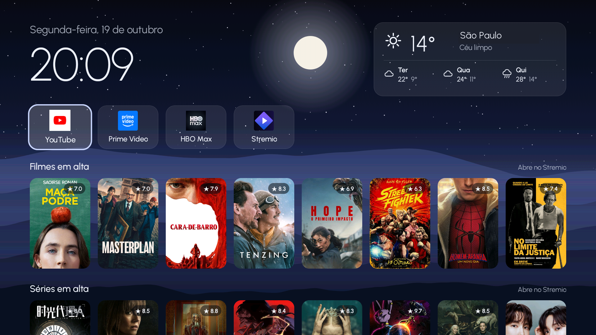

# tvhome-custom

A custom Android TV home screen, written as a **reference for your coding agent**. Copy a prompt, paste it into Claude Code, Codex or a similar agent, and it builds you a home screen like this one.

[Português](README.pt-BR.md)



## What it is

One screen, plain Java, no Gradle and no libraries (about 84 KB):

- Your apps as focusable tiles, arranged from the remote: hold **OK** to move, replace or remove, and add any installed app.
- Clock, date and a weather card (Open-Meteo, no key).
- HDMI inputs and shortcuts in a bottom row.
- An optional row of trending movies and series (free TMDB key).
- A night and a morning look, a background drawn once, built to stay light on slow TVs.

## Use it with your agent

1. Turn on developer mode on the TV: **Settings → Device Preferences → About**, press **Build** 7 times. Then turn on **USB debugging** (or network debugging) in **Developer options**. The TV and your computer must be on the same Wi-Fi.
2. Open your agent in an empty folder.
3. Open [`PROMPT.md`](PROMPT.md) ([`PROMPT.pt-BR.md`](PROMPT.pt-BR.md) in Portuguese), copy everything below the line, and replace `<REPO_URL>` with this repository's address.
4. Paste it. The agent reads this repo, asks you a few questions (TV, apps, language, weather city, trending row), builds your own version and installs it on your TV, asking before every change.

> [!NOTE]
> This is what worked for us, not professional advice. Use it at your own risk. You're responsible for your own TV.

## What's in the repo

| Path | What it is |
| --- | --- |
| `PROMPT.md`, `PROMPT.pt-BR.md` | The prompt to paste into your agent |
| `src/com/tvhome/example/MainActivity.java` | The home screen: tiles, focus, edit menu, footer, settings |
| `Weather.java`, `Trending.java`, `Net.java` | Weather, TMDB trending row, minimal HTTPS GET |
| `Look.java`, `Landscape.java`, `LineIcon.java` | Night/morning colors, the drawn background, vector icons |
| `assets/` | The bundled font |
| `AndroidManifest.xml` | HOME launcher declaration and app visibility (`queries`) |
| `apps.txt` | Default apps, one package name per line. Copy it to `apps.local.txt` (not kept in git) for your own list |
| `build.sh`, `build.ps1` | Build the APK (macOS/Linux and Windows) |
| `install.sh`, `undo.sh` | Install and set as default home, and undo it |
| `ci/smoke-test.sh`, `.github/workflows/build.yml` | Emulator check and CI |

## Build and run the example yourself

You need Java 17, the Android SDK (platform 34, build-tools 34.0.0) and `adb`. On a Mac:

```sh
brew install openjdk@17 android-platform-tools
brew install --cask android-commandlinetools
sdkmanager "platforms;android-34" "build-tools;34.0.0"
```

On Windows, install `adb` from Google's [SDK Platform Tools](https://developer.android.com/tools/releases/platform-tools) and run the scripts from Git Bash, or use `build.ps1`.

```sh
sh build.sh                      # builds out/tvhome.apk
sh install.sh <TV_IP>            # installs it and makes it the default home
sh install.sh <TV_IP> "com.netflix.ninja,com.google.android.youtube.tv"   # or choose the apps
sh undo.sh <TV_IP>               # puts the TV back
```

Most TVs keep opening their own home screen, so `install.sh` offers to turn that off. Nothing is uninstalled.

The signing key is created on your first build in `~/.tvhome` (`key.jks` and `key.pass`), outside the repo. Back it up: updates must be signed with the same key.

For the trending row, get a free API key at [themoviedb.org](https://www.themoviedb.org/settings/api) and send it to the TV:

```sh
adb shell am start -n com.tvhome.example/.MainActivity --es tmdb <YOUR_KEY>
```

## Credits

This product uses the TMDB API but is not endorsed or certified by TMDB.

MIT License. See [LICENSE](LICENSE).
